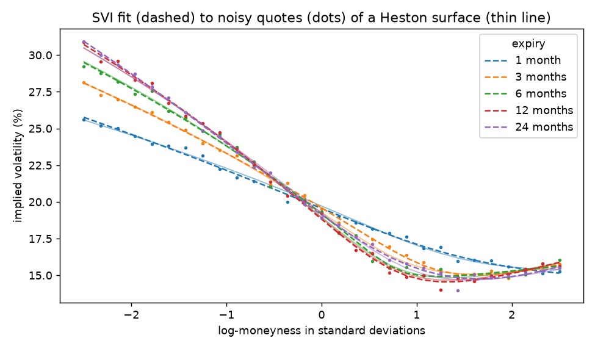
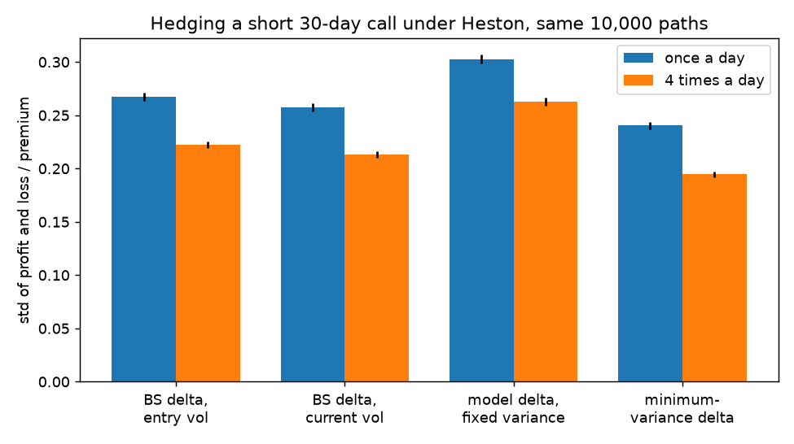

# volsurf

European option pricing, implied volatility, SVI volatility surfaces and delta-hedging experiments,
written from scratch with numpy and scipy. It runs on a laptop. The "market" in every experiment is
a Heston model, so the right answer is known and the code can be held to it.

## What is in the package

| module | what it does |
|---|---|
| `bs` | Black-Scholes-Merton prices and Greeks, including vanna and volga |
| `iv` | implied volatility from the out-of-the-money option (put-call parity for in-the-money quotes), safeguarded Newton on the log price |
| `heston` | semi-analytic price (Lewis integral, "little trap" characteristic function), a vectorised grid pricer, Andersen QE path simulation |
| `svi` | raw SVI slices, a fit that is linear in three of the five parameters, Lee's wing bound, butterfly checks and the implied density |
| `surface` | a surface of SVI slices, calendar spread checks and repair, linear interpolation of total variance in time |
| `hedging` | delta hedging of a short call with four hedge ratios on the same paths, paired bootstrap of the ratio of spreads |
| `inverse` | coin-margined (inverse) options: premium, delta, gamma and vega in coins |

## What the tests check

- Implied volatility: a round trip over a wide grid reprices to better than 1e-11 of the spot, deep
  out-of-the-money tails keep a relative accuracy of 1e-8, prices outside the no-arbitrage band give
  NaN instead of a number.
- Heston: the characteristic function is a martingale transform, vanishing vol of vol gives
  Black-Scholes back, put-call parity holds, the grid pricer agrees with adaptive quadrature, and a
  Monte Carlo price from the QE paths agrees with the semi-analytic one.
- SVI: derivatives match finite differences, the density derived from the slice matches the second
  derivative of Black-Scholes prices in the strike, integrates to one and has the forward as its mean,
  and a steep slice produces the negative density its butterfly check predicts.
- Fits: noiseless data are reproduced, noisy and sparse data are fitted, nearly straight smiles do
  not make the search run away, and Lee's bound holds exactly.
- Inverse options: the premium equals `K` times a put on the reciprocal spot (the symmetry of the two
  currencies), checked independently of the implementation.

```
pip install -e ".[dev,plots]"
pytest
```

## Fit quality against a Heston surface

`scripts/fit_quality.py`: five expiries from one to twenty-four months, 29 quotes each between minus
and plus 2.5 standard deviations, Heston implied volatilities as the truth. One slice is fitted per
expiry. Results are in `results/fit_quality.json`.



On exact quotes the fit is within 0.02 to 0.06 volatility points per expiry (0.002 at two years) and
never further than 0.1 points from the truth, with no arbitrage flagged anywhere.

With Gaussian noise of 0.29 volatility points on every quote, over 20 seeds:

| | no repair | repair where both expiries are quoted | repair on a wide grid |
|---|---:|---:|---:|
| error against the truth, mean over runs (points) | 0.128 | 0.128 | 1.03 |
| error against the truth, worst run (points) | 0.152 | 0.152 | 18.2 |
| runs with a calendar crossing where both expiries are quoted | 0 | 0 | 1 |
| runs with a calendar crossing within 0.9 of the forward in log-moneyness | 5 | 5 | 1 |
| runs with a calendar crossing within 3 | 9 | 9 | 0 |
| runs with a butterfly violation within 0.9 | 2 | 2 | 2 |

- The fitted surface is 2.3 times closer to the truth than the quotes are.
- Where two expiries are both quoted the slices never crossed, so the default repair had nothing to
  do and equals the unrepaired fit. The crossings that exist are outside the quotes, where nothing
  constrains independent slices.
- Forcing the wings into order with pseudo-quotes costs accuracy at the quotes (one run is 18 points
  off) and still leaves a crossing in one run and every butterfly violation in place. A
  parametrisation that is free of arbitrage by construction (SSVI) is the right tool for that, and
  it is not implemented here.

## Delta hedging under Heston

`scripts/hedging_experiment.py`: a short 30-day at-the-money call (spot and strike 100, premium
2.22, entry implied volatility 19.4 percent) under Heston with v0 = 0.04, kappa = 2, theta = 0.04,
xi = 0.6 and rho = -0.7 (the Feller condition does not hold), zero rates, 10,000 paths. The hedger
sells the call at its model price and trades the underlying; all strategies run on the same paths.
Results are in `results/hedging.json`.



| hedge ratio | once a day: std / premium | ratio to the minimum-variance delta | four times a day: std / premium | ratio |
|---|---:|---:|---:|---:|
| none | 1.295 | 5.39 [5.25, 5.53] | 1.276 | 6.55 [6.41, 6.71] |
| Black-Scholes delta at the entry implied volatility | 0.268 | 1.11 [1.10, 1.13] | 0.222 | 1.14 [1.13, 1.15] |
| Black-Scholes delta at the current implied volatility | 0.257 | 1.07 [1.06, 1.08] | 0.213 | 1.10 [1.09, 1.10] |
| model delta at fixed variance | 0.303 | 1.26 [1.25, 1.27] | 0.263 | 1.35 [1.33, 1.36] |
| minimum-variance delta | 0.240 | 1 | 0.195 | 1 |

The ratios come from a paired bootstrap over paths (95 percent interval in brackets).

- The model delta at fixed variance is worse than the Black-Scholes delta at the implied volatility:
  with rho = -0.7 the variance moves with the spot, and the plain delta ignores that. Adding
  `rho * xi / S * dC/dv` gives the narrowest spread; the Black-Scholes delta leaves a spread 7 to
  14 percent wider.
- Hedging four times a day instead of once narrows every spread by 13 to 19 percent, far from the
  factor of two that discretisation error alone would give: most of what is left is volatility risk
  that the underlying cannot hedge.
- The mean profit and loss is zero within about two standard errors for every strategy, as it must
  be when the premium is the model price.

## Limits

- The hedger knows the true model and its parameters. The numbers say which hedge ratio is better
  inside this model, not in a market. There are no transaction costs, no jumps, one parameter set and
  one seed of 10,000 paths.
- On 5.7 percent (daily) and 7.0 percent (four times a day) of the hedge dates the option is so
  close to its intrinsic value that no Black-Scholes implied volatility exists; the entry volatility
  is used there.
- The quotes are exact Heston implied volatilities plus independent Gaussian noise: no bid-ask
  spread, no stale quotes, no missing strikes.
- Independent raw SVI slices carry no joint guarantee of freedom from arbitrage; the calendar repair
  is a heuristic.

## Reproduce

```
python scripts/fit_quality.py            # about 40 s
python scripts/hedging_experiment.py     # about 4 min
python scripts/make_figures.py
```

Python 3.11 or later. Apache-2.0.
